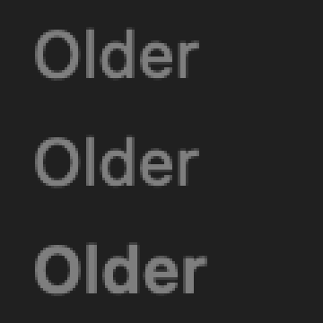
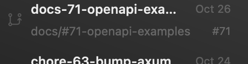

# What Monocode's patched GPUI does that this app does not

gwm-gpui runs on `gpui-pre` 0.3.11 from crates.io, unmodified. Monocode Native
patches its copy of GPUI (`vendor/` in its repo, 0.3.9). This page lists what
those patches buy that shows here, measured on gwm-gpui's own off-screen
renders (`examples/screenshot.rs`, on a plain backdrop). Vendoring is a
decision for the maintainer: nothing here is vendored.

## Medium weight renders as regular

The sidebar's section title, top to bottom: `FontWeight::NORMAL`, `MEDIUM`,
`SEMIBOLD`. The first two are identical to the pixel (0 differing pixels); only
semibold is heavier. SF has a Medium face, but stock GPUI does not reach it.
Monocode snaps weights to the nearest 100 in
`vendor/gpui-pre-apple/src/text_system.rs`. Here, every medium label (section
titles) shows as regular.

## No edge fades: ellipses instead

Monocode fades text out at the edge of a tab label and fades the sidebar list
at its top and bottom while it scrolls, with masks in
`vendor/gpui-pre-apple/src/metal_renderer.rs`. Here, long names end in an
ellipsis, and the list is cut off flat.

## Not visible off screen

- **Traffic light placement.** Monocode re-pins the buttons with Auto Layout
  (`crates/monocode-gpui/src/traffic_lights.rs`); this app sets
  `traffic_light_position` only. macOS draws the buttons, so they are not in an
  off-screen render: check them in the running app.
- **The window's blur** comes from the window server. Stock 0.3.11 already uses
  the `UnderWindowBackground` material (`gpui-pre-macos` `src/window.rs`) that
  Monocode had to patch into 0.3.9, so no gap is expected, but it can only be
  seen in the running app.

## No gap, measured

- **Alpha blending.** The stacked translucent fills compose as source-over: the
  window's alpha reads 0.859 where the 0.85 shell and the 0.05 wash overlap
  (0.85 + 0.05 × 0.15). Measured with the shell at 0.85, before it was lowered
  to match the captures.
- **The card's corners.** Monocode clips them with a Metal mask. Here the four
  corners outside the card's rounding are painted with the chrome's wash
  (`card_corners` in `src/workspace.rs`), as Monocode does where it has no mask.
